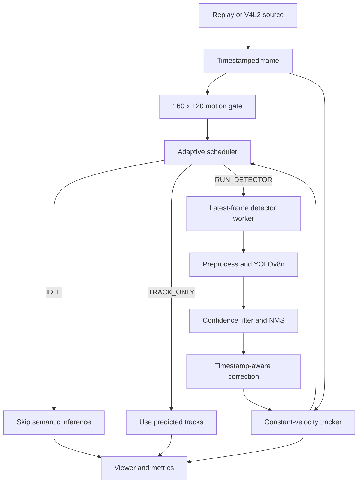

# LeanVision

**Adaptive, freshness-aware person detection on the Arduino UNO Q**

LeanVision is a C++ edge-video runtime that treats neural-network inference as a
schedulable resource. Instead of running YOLO on every frame, it combines a cheap motion
gate, a timestamp-aware tracker, and an adaptive state machine to decide when a fresh
semantic result is actually needed.

The final board demo processes a 640 x 360, 15 FPS recording in real time while avoiding
**92.67%** of potential detector calls.

## Abstract

Continuous edge-vision systems often spend most of their compute repeatedly analyzing
nearly identical frames. LeanVision reduces that waste with a closed-loop inference
pipeline for the Arduino UNO Q. A low-resolution motion gate measures scene activity, a
custom constant-velocity tracker propagates person detections between model executions,
and an adaptive scheduler selects `IDLE`, `TRACK_ONLY`, or `RUN_DETECTOR` from motion,
track health, unexplained activity, and semantic age. YOLOv8n inference runs
asynchronously through a bounded latest-frame worker, preventing slow inference from
blocking video processing or creating a stale FIFO backlog. Timestamped detector results
are applied to historical tracker state and then propagated forward to the present.

On a 60-second, 900-frame board evaluation, LeanVision sustained **15.01 FPS** while
executing the detector only **66 times**, avoiding **834 of 900** potential calls with no
dropped results or stale tracker batches. The selected INT8 model is **72.6% smaller** and
has **25.0% lower median inference latency** than FP32. A 300-frame parity test matched
all detections, with mean bounding-box IoU **0.9768** and maximum confidence difference
**0.0171**. These results show that freshness-aware scheduling can preserve responsive
edge perception even when one inference takes longer than one video-frame period.

## Why this is different

LeanVision is more than a quantized object detector:

- **Inference is adaptive, not periodic.** Motion, tracker health, unexplained motion,
  and semantic age determine when YOLO runs.
- **Fresh work wins.** The detector worker has one in-flight request and one replaceable
  pending request, so overload cannot grow into an unbounded queue.
- **Delayed results are time-corrected.** Each detection carries its source timestamp;
  the tracker corrects historical state and re-predicts to the current frame.
- **The control plane is measurable.** Every frame records its state, action, reason,
  motion score, result age, and timing.
- **The detector is replaceable.** Tracking and scheduling depend on the C++ `Detector`
  interface rather than ONNX Runtime directly.

## Architecture



### Frame processing

For every source frame, the runtime:

1. Decodes the frame and preserves its source timestamp.
2. Downsamples it to a 160 x 120 grayscale motion grid.
3. Predicts existing tracks to the new timestamp.
4. Builds scheduler inputs from motion, track lifecycle, and detector availability.
5. Chooses `IDLE`, `TRACK_ONLY`, or `RUN_DETECTOR`.
6. Publishes tracked boxes and live telemetry without waiting for asynchronous inference.
7. Applies any completed detection at its original timestamp and re-propagates tracker
   history to the present.

### Motion gate

The motion gate area-averages the input into a grayscale grid and compares adjacent
frames. It reports:

- changed-pixel count and fraction;
- motion-active state and cooldown-controlled motion events;
- motion occurring outside tracked boxes; and
- changed pixels inside each track, used to stop velocity drift when a person is still.

Motion is only a trigger. It does not identify or track a person.

### Tracker

Each track stores its center, size, velocity, lifecycle counters, last detector timestamp,
last detector score, and stable ID. Between detector calls:

```text
cx <- cx + vx * dt
cy <- cy + vy * dt
```

Fresh detections associate through IoU first, then a normalized center-distance fallback.
The final demo uses:

| Parameter | Value | Purpose |
|---|---:|---|
| Match IoU | `0.30` | Primary overlap-based association |
| Match distance | `0.80` box heights | Fast-mover and delayed-result fallback |
| Position gain | `0.70` | Pull prediction toward a new measurement |
| Velocity gain | `0.30` | Correct estimated motion |
| Size gain | `0.50` | Smooth width and height changes |
| Minimum hits | `2` | Confirm a low-score tentative track |
| Immediate confirmation | score `>= 0.60` | Confirm a strong first detection |
| Maximum misses | `3` detector results | Delete an unsupported confirmed track |
| Maximum track age | `2000 ms` | Bound detector-free lifetime |
| Correction history | `1000 ms` | Reconcile delayed detector results |

The tracker does not create its own confidence percentage. `score` is the most recent
YOLO confidence; tracker health is derived from confirmation, hits, misses, age, abrupt
velocity changes, and frame bounds.

### Scheduler

The scheduler is a pure state machine with three runtime states:

| State | Meaning |
|---|---|
| `IDLE` | No confirmed person and no recent activity |
| `RECHECK` | Waiting for semantic confirmation |
| `ACTIVE` | At least one person has been confirmed |

It can request inference for `startup`, `motion_event`, `motion_no_track`,
`unexplained_motion`, `tracker_weak`, `tracker_failed`, `abrupt_motion`,
`confirm_track`, `max_semantic_age`, or `idle_poll`.

Periodic checks are suppressed while the detector is busy. Urgent tracker failures and
motion-driven checks can replace an older pending request under the `latest` policy.

### Asynchronous detector

The current backend is YOLOv8n through ONNX Runtime's CPU execution provider. The model
uses a static 320 x 256 input and person-only postprocessing. Preprocessing performs
letterbox resize, bilinear sampling, HWC-to-CHW conversion, and normalization into one of
two preallocated tensors.

The worker owns at most:

- one inference in flight; and
- one pending tensor, replaceable by a newer request.

This bounded design gives deterministic memory use and prevents stale-frame buildup.

## Verified results

### Final adaptive board demo

Environment: Arduino UNO Q Linux side, four ARM cores, Debian 13, ONNX Runtime 1.31.0,
YOLOv8n INT8, 640 x 360 prerecorded input at 15 FPS, real-time replay, asynchronous
detector, annotated browser viewer enabled.

| Metric | Result |
|---|---:|
| Source frames | 900 |
| Source duration | 59.93 s |
| Wall time | 59.97 s |
| End-to-end throughput | **15.01 FPS** |
| Completed detector calls | **66** |
| Potential calls avoided | **834 / 900** |
| Detector calls avoided | **92.67%** |
| `TRACK_ONLY` decisions | 644 |
| `IDLE` decisions | 189 |
| `RUN_DETECTOR` decisions | 67 |
| Pending requests replaced | 1 |
| Inference p50 / p95 | 146.74 / 160.17 ms |
| Motion p50 / p95 | 5.51 / 6.88 ms |
| Peak RAM | 93.23 MB |
| Average process CPU | 120.0% (about 1.2 core-equivalents) |
| Dropped detector results | 0 |
| Stale tracker batches | 0 |

At 15 FPS, a frame arrives every 66.7 ms, while median inference takes 146.7 ms inside
the full pipeline. Real-time output is possible because inference is sparse, bounded,
and concurrent with motion analysis and tracking.

### FP32 versus INT8 on the board

Every-frame synchronous baseline over the bundled 300-frame validation clip
(`runtime/tests/data/test.mov`):

| Metric | FP32 | INT8 | Change |
|---|---:|---:|---:|
| Model size | 12.13 MB | 3.32 MB | **72.6% smaller** |
| Inference p50 | 155.01 ms | 116.23 ms | **25.0% lower** |
| Inference p95 | 159.07 ms | 118.78 ms | **25.3% lower** |
| Throughput | 5.89 FPS | 7.67 FPS | **30.2% higher** |
| Peak RAM | 90.48 MB | 90.73 MB | approximately equal |
| Model load | 176.63 ms | 643.85 ms | INT8 has higher one-time startup cost |

### FP32-to-INT8 parity

The parity test compares class-matched FP32 and INT8 detections frame by frame after a
0.25 confidence filter. A match requires IoU at least 0.90, and the entire run fails for
missing frames, missing or extra detections, or confidence drift above 0.02.

| Metric | Result |
|---|---:|
| Frames compared | 300 |
| FP32 / INT8 detections | 300 / 300 |
| Matched detections | **300** |
| Unmatched FP32 / INT8 detections | 0 / 0 |
| Minimum IoU | **0.9561** |
| Mean IoU | **0.9768** |
| Maximum confidence delta | **0.0171** |
| Gate | **PASS** |

Parity measures agreement with the FP32 reference, not accuracy against human-annotated
ground truth.

## Repository layout

```text
runtime/                  C++17 deployment runtime
  app/                    edge_ai_runtime executable
  include/edge_ai/        public module interfaces
  src/                    capture, motion, tracker, scheduler, detector, viewer
  config/runtime.json     final adaptive board configuration
  tests/                  native unit and integration tests
  scripts/                board setup and Linux validation
src/edge_detector/        Python correctness and experimentation reference
tests/                    Python unit tests
models/                   FP32 and INT8 ONNX demo models
recordings/               reproducible demo input
tools/model/              ONNX quantization tooling
```

## Build and test

### Python reference

Install [`uv`](https://docs.astral.sh/uv/), then:

```bash
uv sync --dev --extra export
uv run pytest
```

### Native runtime

On the UNO Q, the setup script installs system dependencies, installs or locates ONNX
Runtime, builds the runtime, runs the native tests, and performs a model smoke test:

```bash
git clone https://github.com/Sarves1911/edge-ai-hackathon.git
cd edge-ai-hackathon
runtime/scripts/setup_board.sh --model models/yolov8n-int8.onnx
```

For a manual build when ONNX Runtime is already installed:

```bash
export ONNXRUNTIME_ROOT=/opt/onnxruntime
export LD_LIBRARY_PATH=/opt/onnxruntime/lib:${LD_LIBRARY_PATH:-}

cmake -S runtime -B runtime/build \
  -DCMAKE_BUILD_TYPE=Release \
  -DONNXRUNTIME_ROOT="$ONNXRUNTIME_ROOT"
cmake --build runtime/build -j"$(nproc)"
ctest --test-dir runtime/build --output-on-failure
```

The V4L2 source test is hardware-dependent and skips when no configured capture device is
available. Replay mode does not require a camera.

## Run the board demo

The repository contains the original 1920 x 1080, 15 FPS recording. Generate the
board-friendly 640 x 360 copy once with FFmpeg:

```bash
ffmpeg -y \
  -i recordings/single_person.mp4 \
  -vf "scale=640:360:flags=lanczos" \
  -r 15 -an -c:v libx264 -preset veryfast -crf 23 -pix_fmt yuv420p \
  recordings/single_person_board.mp4
```

Connect the UNO Q over USB-C and forward the viewer port from the host Mac:

```bash
adb forward tcp:8080 tcp:8080
```

Start the runtime on the board:

```bash
adb shell
cd /home/arduino/edge-ai-hackathon

export LD_LIBRARY_PATH=/opt/onnxruntime/lib:${LD_LIBRARY_PATH:-}

runtime/build/app/edge_ai_runtime \
  --config runtime/config/runtime.json \
  --source replay:recordings/single_person_board.mp4 \
  --model models/yolov8n-int8.onnx \
  --realtime \
  --viewer-port 8080 \
  --viewer-fps 5 \
  --output runs/judge-demo
```

While the runtime is active, open the viewer from the Mac:

```bash
open http://localhost:8080
```

The viewer shows annotated boxes, stable track IDs, person count, pipeline FPS, runtime
state, current action, scheduler reason, detector calls, and the most recent inference
latency.

## Reproduce the board comparison

Always-on FP32 baseline:

```bash
runtime/build/app/edge_ai_runtime \
  --source replay:runtime/tests/data/test.mov \
  --model models/yolov8n.onnx \
  --mode always --sync --max-frames 300 \
  --no-overlay --viewer-port 0 \
  --output runs/board-fp32-300
```

Always-on INT8 candidate:

```bash
runtime/build/app/edge_ai_runtime \
  --source replay:runtime/tests/data/test.mov \
  --model models/yolov8n-int8.onnx \
  --mode always --sync --max-frames 300 \
  --no-overlay --viewer-port 0 \
  --output runs/board-int8-300
```

Compare their detections:

```bash
uv run edge-detect compare \
  --reference runs/board-fp32-300/detections.jsonl \
  --candidate runs/board-int8-300/detections.jsonl \
  --min-iou 0.90 \
  --score-tolerance 0.02
```

Run the adaptive candidate:

```bash
runtime/build/app/edge_ai_runtime \
  --config runtime/config/runtime.json \
  --source replay:recordings/single_person_board.mp4 \
  --model models/yolov8n-int8.onnx \
  --realtime \
  --output runs/board-int8-adaptive
```

## Run artifacts

Every native run writes:

| File | Contents |
|---|---|
| `effective_config.json` | Exact configuration used for the run |
| `frames.csv` | Per-frame state, action, reason, motion, and timing |
| `detections.jsonl` | Original-coordinate boxes and stable `track_id` values |
| `summary.json` | Latency percentiles, calls avoided, CPU, RAM, and worker statistics |

The browser overlay is a presentation layer. JSONL and summary artifacts remain the
machine-readable interface for downstream applications and evaluation.

## Applications

The control architecture can wrap other detection models without changing its core:

- security and restricted-area monitoring;
- industrial worker, forklift, and PPE detection;
- traffic, parking, and queue monitoring;
- wildlife cameras and battery-constrained sensing;
- robot or drone target reacquisition; and
- local event filtering before network upload.

It provides the largest benefit when consecutive frames are redundant. In crowded,
rapidly changing scenes, the scheduler correctly requests inference more often and the
compute savings decrease.

## Current scope and limitations

- The shipped model is stock COCO YOLOv8n filtered to the `person` class; it is not a
  custom-trained safety or surveillance model.
- The submitted demonstration uses prerecorded video for repeatability. A Linux V4L2
  source is implemented and tested separately.
- The lightweight tracker has no appearance embedding or ReID. Heavy occlusion and dense
  crossings can still change identities.
- The production detector currently uses ONNX Runtime on the CPU. The Adreno GPU is
  visible through Vulkan/OpenCL, but GPU inference is not claimed by this runtime.
- FP32/INT8 parity establishes backend agreement on the evaluation clip, not ground-truth
  detection accuracy.

## Key configuration

The final policy is stored in [`runtime/config/runtime.json`](runtime/config/runtime.json).
Unknown keys and out-of-range values are rejected during configuration loading.

The Python implementation remains the correctness and experimentation reference. The
C++ runtime is the deployment path used for the Arduino UNO Q demonstration.
